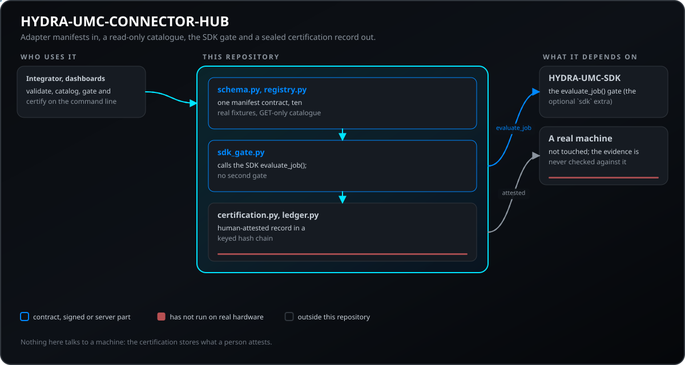
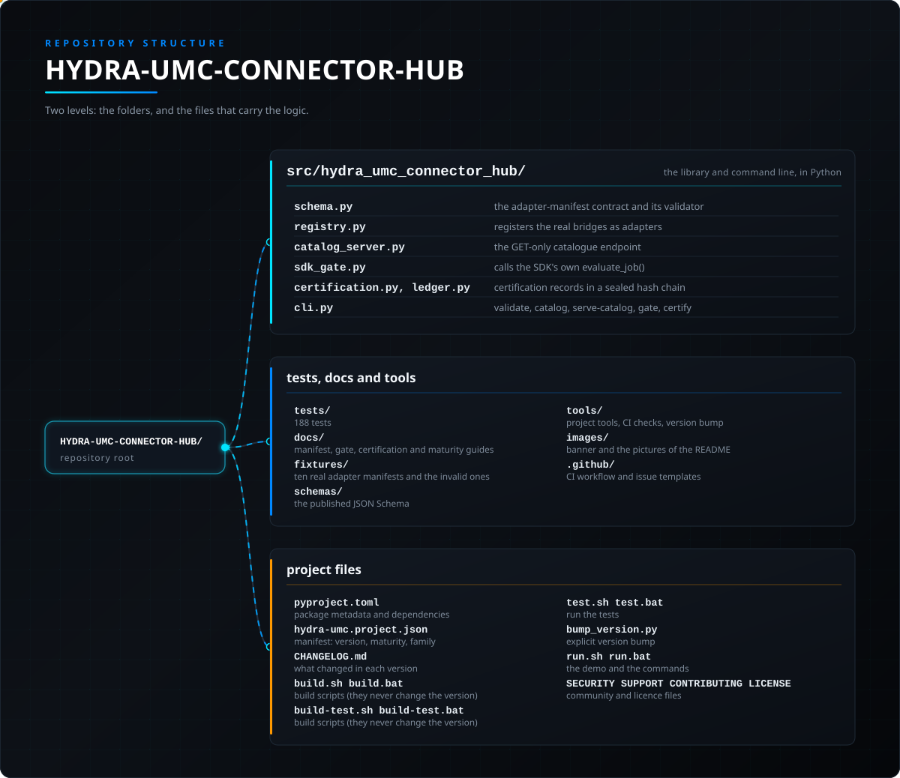

<!-- =============================================================================
HYDRA-UMC-CONNECTOR-HUB - Adapter-manifest registry
Copyright (C) JuanenRac (Electro Hobby 3D) <electrohobby3d@gmail.com>
GPL-3.0-or-later - see LICENSE
============================================================================= -->

<p align="center">
  
</p>

# 🔌 HYDRA-UMC-CONNECTOR-HUB

<p align="center"><a href="README.md">🇺🇸 English</a> | 🇪🇸 <b>Español</b> | <a href="README_fra.md">🇫🇷 Français</a> | <a href="README_ita.md">🇮🇹 Italiano</a> | <a href="README_deu.md">🇩🇪 Deutsch</a> | <a href="README_zho.md">🇨🇳 简体中文</a> | <a href="README_jpn.md">🇯🇵 日本語</a> | <a href="README_por.md">🇵🇹 Português</a></p>

### 🧩 Un registro declarativo y validador para adaptadores de máquinas externas

<p align="center">
  
  
  
  
  
  
  
</p>

---

> **Estado: v0.1.5, functional - Entregas 1-4 de 4 (esquema/CLI/
> fixtures, catálogo de solo lectura, puerta de seguridad del SDK,
> registros de certificación).** `catalog`/`serve-catalog` son reales y
> de solo GET (no existe ninguna ruta de escritura por red en todo el
> proyecto); `gate` llama directamente al propio `evaluate_job()` real de
> HYDRA-UMC-SDK, nunca una segunda implementación de esa puerta (ver
> [docs/CAPABILITY_GATE.md](docs/CAPABILITY_GATE.md)); `certify` registra
> una evidencia real atestiguada por un humano pero explícitamente NO la
> verifica de forma independiente contra hardware real - ver
> [docs/CERTIFICATION.md](docs/CERTIFICATION.md) para exactamente por
> qué eso queda fuera de alcance sin una máquina física a mano. Ver
> [docs/CLI_REFERENCE.md](docs/CLI_REFERENCE.md) para la superficie de
> comandos exacta que existe hoy.

> **Comprobación de honestidad - qué funciona realmente hoy:** el esquema/validador de manifiestos (`schema.py`), el catálogo de solo lectura (`registry.py`, `catalog_server.py`), la integración de la puerta de seguridad del SDK (`sdk_gate.py`, que llama al propio `evaluate_job()` real de `HYDRA-UMC-SDK` contra un checkout realmente instalado, nunca una simulación), el registro de certificación (`certification.py`), y la CLI (`cli.py`) son reales y están cubiertos por 188 tests que pasan (`pytest tests/`, con el extra opcional `[sdk]` instalado - 34 se omiten sin él). `certify` registra una evidencia atestiguada por un humano pero explícitamente no la verifica de forma independiente contra hardware real - no hay ninguna máquina física detrás de ninguna de las 10 fixtures, y ningún adaptador de aquí se ha usado jamás para hablar realmente con un dispositivo real. `catalog`/`serve-catalog` son solo GET por construcción (`catalog_server.py` no tiene ningún `do_POST`/`do_PUT`). Ver el aviso de Estado más arriba y `CHANGELOG.md` para lo que se ha entregado exactamente hasta ahora.

> **Estado de seguridad física y de ciberseguridad:** este ecosistema no es un sistema de seguridad certificado. Todavía no existe una ruta de E-STOP por hardware, ni límites ni enclavamientos aplicados por el firmware, ni un comando de movimiento verificado; las imágenes de firmware se comprueban con CRC32 y un HMAC-SHA256 de clave compartida, no con una firma asimétrica; TLS y TLS mutuo son opcionales y están desactivados por defecto; aún no se ha poblado ni probado ninguna placa propia. Lee la [línea base de seguridad](https://github.com/JuanenRac/HYDRA-UMC-DOCS/blob/main/docs/SECURITY_BASELINE.md) y el [modelo de amenazas](https://github.com/JuanenRac/HYDRA-UMC-DOCS/blob/main/docs/THREAT_MODEL.md) antes de fiarte de cualquier afirmación de aquí para la seguridad de una persona.

---

## 📋 De un vistazo

| | |
|---|---|
| Versión | `0.1.5` |
| Madurez | Funcional |
| Tests | 188 (`python -m pytest -q tests`) |
| Tecnología | Python 3.11+ / JSON Schema (hand-written structural validator, no jsonschema dependency) / http.server (stdlib-only real read-only catalog endpoint) / HYDRA-UMC-SDK (optional, real safety-gate integration via evaluate_job()) |
| Destino | El PC de quien lo usa |
| En hardware real | Todavía no: no consta ninguna ejecución en hardware real para esta versión |

**Ir a:** [Resumen](#-resumen) · [Arquitectura](#-arquitectura) · [Seguridad y protección](#-seguridad-y-protección) · [Interfaces](#-interfaces) · [Configuración](#-configuración) · [Inicio rápido](#-inicio-rápido) · [Pruebas](#-pruebas) · [Resolución de problemas](#-resolución-de-problemas) · [Estructura del repositorio](#-estructura-del-repositorio) · [Proyectos relacionados](#-proyectos-relacionados)

## 🚦 Estado del proyecto

Cada línea es una parte de este repositorio y la luz dice hasta dónde llega hoy. Se escribe con lo que el repositorio puede demostrar (pruebas, compilaciones, ejecuciones), no con lo previsto.

🟢 Hecho y verificado · 🟡 Funciona, con límites conocidos · 🟠 Hecho a medias o sin verificar · 🔴 Sin hacer o sin funcionar

| Área | Estado | Qué significa aquí |
|---|---|---|
| Software | 🟡 | Funciona para su propósito principal; la comprobación de honestidad de arriba lista lo que aún falta |
| Pruebas | 🟢 | 188 pruebas automáticas, ejecutadas en cada cambio |
| Hardware real | 🔴 | Todavía no: no consta ninguna ejecución en hardware real para esta versión |
| Documentación | 🟢 | README en ocho idiomas, comprobado contra el manifiesto en cada cambio |

## 🎯 Resumen

Hoy, elegir y configurar qué bridge usa una célula o máquina concreta
está repartido entre READMEs, archivos `.env` y scripts ad-hoc en muchos
repositorios de bridges reales. HYDRA-UMC-CONNECTOR-HUB está pensado
para convertirse en el único lugar que responde, para cualquier máquina
externa real, a tres preguntas: **¿qué protocolo habla, qué puede hacer
de verdad (leer/escribir/abortar, con qué riesgo), y qué proyecto real ya
existente de este ecosistema lo implementa?**

Esta versión envía las cuatro entregas previstas, en seis partes:

1. **Un contrato real y fijo** ([docs/ADAPTER_MANIFEST.md](docs/ADAPTER_MANIFEST.md)) -
   el "CONTRATO MINIMO DE ADAPTADOR" de este
   ecosistema, con una regla no negociable ya aplicada en código:
   una capacidad `write`/`abort` se rechaza a menos que declare también
   su propio riesgo, permiso requerido, estado de celda requerido,
   exigencia de confirmación humana y timeout.
2. **Un validador CLI real** (`hydra-umc-connector-hub validate`) - una
   comprobación estructural escrita a mano (sin dependencia de
   `jsonschema`), de modo que cada error real nombra el
   adaptador/campo/capacidad exacto responsable.
3. **Diez fixtures reales**, una por cada proyecto de bridge/protocolo
   ya existente en este ecosistema - prueba de que el contrato no es
   teórico, y una plantilla de partida para un nuevo manifiesto de
   adaptador.
4. **Un catálogo real de solo lectura** (`catalog`/`serve-catalog`) -
   descubre cada manifiesto estructuralmente válido de un directorio y,
   con `serve-catalog`, lo expone por un `http.server` real de solo GET
   (no existe ninguna ruta de escritura en todo el proyecto).
5. **Una integración real con la puerta de seguridad de HYDRA-UMC-SDK**
   (`gate`) - una llamada a una capacidad `write`/`abort` pasa por el
   propio `evaluate_job()` real del SDK, nunca una segunda
   implementación de esa lógica; ver
   [docs/CAPABILITY_GATE.md](docs/CAPABILITY_GATE.md).
6. **Registros de certificación reales** (`certify`/`certifications`) -
   un registro real, atestiguado por un humano y de solo-anexar,
   comprobado contra el `evidenceSchema` propio de un adaptador; ver
   [docs/CERTIFICATION.md](docs/CERTIFICATION.md) para por qué verificar
   la evidencia de forma independiente contra hardware real queda
   explícitamente fuera de alcance aquí.

```
$ hydra-umc-connector-hub validate fixtures/industrial-opcua.json
VALID fixtures/industrial-opcua.json adapterId='industrial-opcua' ownerProject='HYDRA-UMC-OPCUA-SERVER'

$ hydra-umc-connector-hub catalog --registry-dir fixtures | head -c 200
{"adapters": [{"adapterId": "cnc-grbl", "protocol": "grbl-serial", ...

$ hydra-umc-connector-hub gate fixtures/cnc-grbl.json --capability grblStatus \
    --job-id j1 --idempotency-key i1 --source studio --cell-state READY --machine-state IDLE
{"allowed": true, "reason": "read capabilities are not subject to the motion safety gate", "evidenceErrors": []}

$ hydra-umc-connector-hub certify fixtures/cnc-grbl.json --machine-model "Genmitsu 3018-PROVer" \
    --certified-by "Juan Enrique" --evidence-file real-status.json --out-dir certifications/
CERTIFIED adapterId='cnc-grbl' certificationId='...' -> certifications/cnc-grbl__....json
```

No existe ninguna invocación por defecto/sin argumentos ni GUI en todo
este proyecto - ver [docs/CLI_REFERENCE.md](docs/CLI_REFERENCE.md) para
la superficie de comandos completa y real.

## 🧩 Papel en HYDRA-UMC

**HYDRA-UMC-CONNECTOR-HUB** describe cómo se conectan las máquinas externas al ecosistema, sin conectarse a ninguna. Un adaptador dice en un manifiesto qué es, qué puede hacer (leer, escribir, abortar) y cómo se autentica; el hub lo valida, lo lista, pasa una capacidad pedida por la puerta real del SDK y guarda un registro de quién certificó qué.

## 🏛️ Arquitectura

<p align="center">
  
</p>

**Por qué está hecho así**

- **Un validador escrito a mano, no `jsonschema`.** El propio contrato
  de la Entrega 1 es lo bastante pequeño (14 campos de primer nivel, una
  forma de capacidad anidada) para que una función Python sencilla que
  recolecta cadenas de error reales y específicas sea a la vez más
  simple que un validador JSON-Schema genérico Y produzca una salida más
  clara - cada mensaje nombra el campo/índice exacto responsable, no una
  ruta de esquema genérica.
- **La regla de seguridad write/abort se aplica en código, no en
  documentación.** `_WRITE_CAPABILITY_REQUIRED_FIELDS` en `schema.py` es
  esa regla explícita convertida en una
  comprobación real y probada - quien escribe un manifiesto no puede
  olvidarla, porque el validador rechaza una capacidad que lo haga.
- **`authenticationRef` se comprueba como una referencia, nunca se
  confía en ella como texto libre.** Un conjunto cerrado de prefijos
  reales (`env:`, `secret-store:`, `vault:`, `none:`) - deliberadamente
  no una heurística de "parece un secreto" (ver el propio
  `log_redaction.py` de HYDRA-UMC-OPS-AGENT para por qué una heurística
  es la herramienta equivocada también para este mismo problema).
- **Se recolecta cada error, nunca solo el primero.**
  `validate_adapter_manifest()` sigue comprobando después de encontrar
  un problema - quien arregla un manifiesto ve todos los problemas
  reales en una sola ejecución.
- **El catálogo es real y de solo lectura, a propósito.** `registry.py`
  escanea un directorio sin recursión (así una `fixtures/invalid/`
  anidada nunca entra en un catálogo real), descarta - pero sigue
  reportando - cualquier cosa que falle `validate_adapter_manifest()`, y
  rechaza dos archivos que declaran el mismo `adapterId`.
  `catalog_server.py` no tiene ningún `do_POST`/`do_PUT` - un intento de
  escritura recibe el propio `501` honesto de
  `BaseHTTPRequestHandler`, nunca una ruta que este proyecto olvidó
  proteger.
- **La puerta de seguridad reutiliza la lógica real de HYDRA-UMC-SDK,
  nunca una segunda implementación de ella.** El
  `evaluate_capability_call()` de `sdk_gate.py` llama directamente a
  `hydra_umc_sdk.bridge_contract.evaluate_job()` para cada capacidad
  `write`/`abort` - una capacidad `read` nunca toca el SDK, ya que
  `evaluate_job()` es una puerta de movimiento/escritura, no una puerta
  de lectura. Ver [docs/CAPABILITY_GATE.md](docs/CAPABILITY_GATE.md)
  para la única simplificación deliberada y nombrada que hace esta
  integración (un `JobPhase` sustituto único para cualquier escritura
  que no sea un abort).
- **Un registro de certificación es honesto sobre lo que puede y no
  puede probar.** `certification.py` se niega a guardar una
  certificación cuya evidencia no coincida con el `evidenceSchema` del
  adaptador, pero nunca afirma verificar de forma independiente que esa
  evidencia proviene de hardware real - no hay ningún camino de código
  en todo este proyecto que abra un puerto serie/sesión OPC-UA/conexión
  MQTT reales para comprobarlo. Ver
  [docs/CERTIFICATION.md](docs/CERTIFICATION.md).
- **Las diez fixtures nombran proyectos propietarios reales, nunca
  inventados.** Cada `ownerProject` en `fixtures/*.json` es un
  repositorio real de este ecosistema (ver la sección Proyectos
  Relacionados) - esto es una plantilla de registro real, no
  especulativa.
- **Solo librería estándar para el núcleo.** `validate`/`catalog`/
  `serve-catalog`/`certify`/`certifications` no necesitan ninguna
  dependencia - `json`, Python plano para las comprobaciones
  estructurales y `http.server`. Solo `gate` sobre una capacidad
  `write`/`abort` necesita el extra opcional `[sdk]`.

## 🔒 Seguridad y protección

| Amenaza | Defensa | Dónde |
|---|---|---|
| Un adaptador que se hace pasar por otro proyecto | El proyecto propietario debe cumplir `^(HYDRA-UMC\|URTC)(-[A-Z0-9-]+)?$` y con `--ecosystem-root` se comprueba contra el `hydra-umc.project.json` de ese repositorio | `schema.py`, `cli.py` |
| Credenciales en un manifiesto, un manifiesto gigante, un modo desconocido | `authenticationRef` solo admite los prefijos `env:`, `secret-store:`, `vault:` o `none:` (nunca el secreto); un manifiesto mide como máximo 1 000 000 bytes; los modos de capacidad son `read`, `write` y `abort`, la idempotencia es `none`, `idempotent`, `at-least-once` o `exactly-once` | `schema.py` |
| Llamar a un adaptador sin la puerta, una petición vieja | `gate` llama al `evaluate_job()` propio del SDK y nunca a una segunda implementación; exige `--allow-unobserved` para fiarse de un estado declarado, y `--human-confirmed`, `--safety-gate` y `--permission` según pida el manifiesto; una petición de más de 30 segundos o más de 5 segundos por delante se rechaza | `sdk_gate.py`, `cli.py` |
| Registros de certificación manipulados y una escritura por la red | Los registros forman una cadena de hash sellada con una clave de 16 caracteres como mínimo (`.chain-head.json`, `.chain.lock`) y `verify --strict` falla ante un registro fuera de la cadena; `catalog` y `serve-catalog` son solo GET: no existe ninguna vía de escritura por red en el proyecto | `ledger.py`, `catalog_server.py` |

**Lo que nunca hace:** nunca toca una máquina, y una certificación guarda lo que una persona atestigua: la evidencia no se comprueba contra hardware real (mira `docs/CERTIFICATION.md`).

## 🔌 Interfaces

El comando `hydra-umc-connector-hub` (o `./run.sh`); la referencia completa es `docs/CLI_REFERENCE.md`. El catálogo también se sirve por HTTP, solo GET, en `127.0.0.1:8801` por defecto.

| Topic o ruta | Qué lleva |
|---|---|
| `validate MANIFEST...` | comprobar manifiestos contra el contrato |
| `catalog --registry-dir DIR`, `serve-catalog --registry-dir DIR --port 8801` | listar los adaptadores, o servir la misma lista por GET (`--ecosystem-root` comprueba además los proyectos propietarios) |
| `gate MANIFEST --capability ... --job-id ... --idempotency-key ... --source ... --cell-state ... --machine-state ...` | pasar una capacidad por la puerta del SDK (`--param k=v`, `--evidence-file`, `--allow-unobserved`, `--human-confirmed`, `--safety-gate`, `--permission`) |
| `certify`, `certifications`, `verify --strict` | registrar la atestación de una persona en la cadena de hash, listar los registros, comprobar la cadena |

## ⚙️ Configuración

No tiene variables de entorno propias: la carpeta del registro, el host y el puerto del catálogo (`--registry-dir`, `--host`, `--port`) y la clave de la cadena de certificación (16 caracteres como mínimo) son argumentos de la línea de órdenes. Las credenciales de un adaptador nunca se escriben en su manifiesto, solo una referencia a dónde viven.

## 🚀 Inicio rápido

Requiere Python 3.11 o superior; el núcleo usa solo la biblioteca estándar (el extra `sdk`, `pip install -e ".[sdk]"`, solo hace falta para `gate` en una capacidad de escritura o aborto).

```bash
chmod +x build.sh   # una sola vez
./build.sh          # crea .venv, pip install -e ".[dev]", compile-check + tests
./run.sh                                   # demo real: valida las diez fixtures reales
./run.sh validate fixtures/industrial-opcua.json
./run.sh validate fixtures/invalid/*.json  # cada una de estas debería reportar INVALID
./run.sh catalog --registry-dir fixtures
./run.sh serve-catalog --registry-dir fixtures --port 8801   # Ctrl+C para parar
pip install -e ".[sdk]"                    # solo necesario para `gate` sobre una capacidad write/abort
./run.sh gate fixtures/cnc-grbl.json --capability sendControlByte --job-id j1 \
    --idempotency-key i1 --source studio --cell-state READY --machine-state IDLE
./run.sh certify fixtures/cnc-grbl.json --machine-model "Genmitsu 3018-PROVer" \
    --certified-by "Tu Nombre" --evidence-file real-status.json --out-dir certifications/
```

En Windows: `build.bat`, y luego `run.bat` (misma demo si se llama sin
argumentos) / cualquiera de los subcomandos anteriores. `build-test.sh`/
`.bat` realiza la misma comprobación de compilación (solo sintaxis
Python), sin mutar nada, que la propia CI de este proyecto realiza -
NO ejecuta la suite de tests por sí solo; la CI ejecuta `pytest` como
un paso separado, posterior. Ejecuta `./build.sh`/`build.bat` (o
`pytest tests/` directamente) para la suite de tests completa en
local.

**Solución de problemas**

- `validate` reporta `INVALID` para un manifiesto que crees correcto:
  lee cada motivo listado - el validador reporta todos, no solo el
  primero. Ver [docs/ADAPTER_MANIFEST.md](docs/ADAPTER_MANIFEST.md)
  para el contrato exacto campo a campo.
- `validate` reporta `ERROR: ... is not valid JSON`: el archivo en sí es
  JSON malformado, algo distinto de un manifiesto bien formado pero
  inválido - revisa una coma o comilla faltante antes de revisar el
  contrato en sí.
- `catalog`/`serve-catalog` termina con código `1` o lista un archivo
  bajo `invalidFiles`: ese archivo falló la validación estructural y se
  dejó fuera del catálogo a propósito - ejecuta `validate` directamente
  sobre él para ver la lista completa de motivos.
- `gate` falla con `ERROR: the optional 'hydra-umc-sdk' package is not
  installed`: ejecuta primero `pip install -e ".[sdk]"` - solo necesario
  para una capacidad `write`/`abort`.
- `gate`/`certify` falla con `ERROR: unknown cell_state ...` o
  `... does not match evidenceSchema`: ver
  [docs/CAPABILITY_GATE.md](docs/CAPABILITY_GATE.md)/
  [docs/CERTIFICATION.md](docs/CERTIFICATION.md) para los valores/formas
  exactos esperados.

## 🧪 Pruebas

188 pruebas automáticas se ejecutan con `python -m pytest -q tests` (39 necesitan el extra `sdk` y se saltan sin él): el esquema y el JSON Schema publicado, el catálogo, la puerta del SDK, la cadena de certificación, la línea de órdenes y entradas hostiles. Sin hardware ni red externa.

El CI ejecuta `HYDRA_UMC_CI=1 python tools/ci_validate.py`, que comprueba el manifiesto, los documentos, los ocho README y las imágenes.

## 🏗️ Compilación y publicación

No hay nada que compilar para publicar: `build.sh` / `build.bat` crean el entorno virtual, instalan el paquete en modo editable y ejecutan las pruebas, y `build-test` solo comprueba. Compilar nunca cambia la versión; solo la sube `python tools/hydra_project_tool.py bump`, que también mueve el registro de cambios. La versión del paquete, la del manifiesto y la del registro de cambios deben coincidir, y `ci_validate.py` falla si no lo hacen.

## 🩺 Resolución de problemas

| Ves | Porque | Haz |
|---|---|---|
| `INVALID` on a manifest | El manifiesto rompe el contrato: un proyecto propietario erróneo, un secreto en `authenticationRef`, un modo desconocido o un cuerpo de más de 1 000 000 bytes | Lee el mensaje de `validate`; `./run.sh validate fixtures/invalid/*.json` muestra cada tipo de fallo |
| `gate` refuses a write or abort capability | El SDK no está instalado, o no se observó el estado, o falta una confirmación que pide el manifiesto | `pip install -e ".[sdk]"`; da `--observed-machine-state`, o `--allow-unobserved` si aceptas el estado declarado; añade `--human-confirmed`, `--safety-gate` y `--permission` según se pida |
| `verify --strict` fails | Un registro de certificación está fuera de la cadena de hash o la clave es incorrecta | Usa la clave con la que se selló la cadena (16 caracteres como mínimo); un registro añadido o editado a mano queda fuera de la cadena por diseño |

## 📂 Estructura del repositorio

<p align="center">
  
</p>

<details>
<summary>Versión en texto del árbol</summary>

```text
HYDRA-UMC-CONNECTOR-HUB/
├── src/hydra_umc_connector_hub/
│   ├── schema.py                                el contrato del manifiesto de adaptador y su validador
│   ├── registry.py                              registra los bridges reales como adaptadores
│   ├── catalog_server.py                        el endpoint de catálogo solo GET
│   ├── sdk_gate.py                              llama al evaluate_job() propio del SDK
│   ├── certification.py ledger.py               registros de certificación en una cadena de hash sellada
│   └── cli.py                                   validate, catalog, serve-catalog, gate, certify
├── tests/                                       188 pruebas
├── docs/                                        guías de manifiesto, puerta, certificación y madurez
├── fixtures/                                    diez manifiestos de adaptador reales y los inválidos
├── schemas/                                     el JSON Schema publicado
├── tools/                                       ejecutor de compilación y pruebas, subida de versión, validador de CI, generadores y comprobaciones de README e imágenes
├── images/                                      banner y las imágenes del README
├── .github/                                     flujo de CI y plantillas de incidencias
├── pyproject.toml                               metadatos del paquete y dependencias
├── hydra-umc.project.json                       manifiesto: versión, madurez, familia
├── CHANGELOG.md                                 qué cambió en cada versión
├── build.sh build.bat                           scripts de compilación (nunca cambian la versión)
├── build-test.sh build-test.bat                 scripts de compilación (nunca cambian la versión)
├── test.sh test.bat                             ejecutan las pruebas
├── bump_version.py / bump_manifest_version.py   subida de versión explícita
├── run.sh run.bat                               la demostración y las órdenes
└── SECURITY.md SUPPORT.md CONTRIBUTING.md CODE_OF_CONDUCT.md LICENSE LICENSE.md
```

</details>

## 🗺️ Hoja de ruta y límites conocidos

**Límites conocidos hoy**

Las cuatro entregas del plan nombrado en el propio manifiesto y
CHANGELOG de este proyecto ya envían código real y probado. Lo que
queda, dicho con honestidad:

- **El hueco de verificación de hardware de la Entrega 4 queda abierto
  a propósito.** `certify` registra una evidencia atestiguada por un
  humano y comprobada contra el `evidenceSchema` propio de un adaptador,
  pero nada en este proyecto confirma de forma independiente que esa
  evidencia proviene de la máquina real nombrada - eso necesita el
  hardware físico en sí, en una célula real, que esta máquina de
  desarrollo no tiene. Ver
  [docs/CERTIFICATION.md](docs/CERTIFICATION.md).
- **Integración con un cliente real: empezada, no terminada.**
  HYDRA-UMC-SERVER ya sondea `serve-catalog` de verdad -
  `GET /api/adapters` y `GET /api/adapters/:adapterId` reenvían el
  catálogo real de este proyecto, de extremo a extremo (ver el propio
  `tools/verify_connector_hub_relay_contract.mjs` de HYDRA-UMC-SERVER,
  que lanza el `serve-catalog` real de este proyecto contra sus propios
  `fixtures/` reales y una instancia real de Server, nunca un mock).
  También se ha instalado como un wheel real en un venv fuera del propio
  checkout de este proyecto y se ha ejecutado desde ahí, confirmando que
  el empaquetado en sí (no solo una instalación editable) funciona. Que
  Studio/Suite/Updater llamen a `gate` por sí mismos sigue siendo trabajo
  real, separado y futuro.
- **Falta un transporte real entre quien llama a `gate`/`certify` y el
  estado real de la célula/máquina.** Hoy, `--cell-state`/
  `--machine-state` los aporta quien llama como valores ya conocidos -
  no hay ningún camino de código aquí que los obtenga en vivo desde
  HYDRA-UMC-SERVER o un servicio de zonas de seguridad.

## 🌍 Idiomas

Este README y los documentos del repositorio existen en ocho idiomas: inglés, español, alemán, francés, italiano, japonés, chino y portugués (Portugal). Se escriben a la vez y el CI comprueba que los ocho ficheros tengan las mismas secciones y los mismos enlaces. Este repositorio no tiene pantalla ni catálogo de mensajes propios, así que no hay cadenas de interfaz que traducir.

## 🔗 Proyectos relacionados

Este proyecto forma parte del ecosistema robótico HYDRA-UMC del mismo autor (JuanenRac / Electro Hobby 3D). Vale la pena conocerlo, ya que una petición podría en realidad tratarse de uno de estos en vez de este repositorio.

**Directamente Relacionados**
- **[HYDRA-UMC-SDK](https://github.com/JuanenRac/HYDRA-UMC-SDK)** — el contrato JSON-Schema compartido contra el que ya valida sus propios comandos cada bridge; el comando `gate` de este hub (Entrega 3) llama directamente a su propio `bridge_contract.evaluate_job()` real para una capacidad write/abort, nunca una segunda implementación de esa puerta.
- **[HYDRA-UMC-OPS-AGENT](https://github.com/JuanenRac/HYDRA-UMC-OPS-AGENT)** — un proyecto nuevo hermano: opera el ciclo de vida de incidencias de mantenimiento de los propios componentes de este ecosistema, mientras que este hub descubre y valida qué puede hacer una máquina/adaptador EXTERNO.
- **[HYDRA-UMC-GATEWAY-INDUSTRIAL](https://github.com/JuanenRac/HYDRA-UMC-GATEWAY-INDUSTRIAL)** — explícitamente NO sustituido por este proyecto: GATEWAY-INDUSTRIAL es un relé de protocolo real con su propia lista blanca de comandos; este hub es un registro/validador declarativo que se sitúa por encima de él y de cada otro bridge, nunca una segunda implementación de ningún protocolo.

**También Forma Parte del Ecosistema**

*Hardware Central y Plataforma*
- **[HYDRA-UMC](https://github.com/JuanenRac/HYDRA-UMC)** — el diseño de la placa madre del brazo robótico: host CM5 + coprocesador STM32H745 de doble núcleo, pensado para coordinar hasta 8 brazos herramienta por CAN-OTA/SPI-OTA (firmware en fase temprana; todavía no hay ninguna placa poblada).
- **[HYDRA-UMC-OS](https://github.com/JuanenRac/HYDRA-UMC-OS)** — capa de producto Raspberry Pi OS reproducible para la CM5: agente de solo lectura, configuración/perfiles validados, aprovisionamiento WiFi de primer contacto.

*Backend y Clientes Centrales*
- **[HYDRA-UMC-SERVER](https://github.com/JuanenRac/HYDRA-UMC-SERVER)** — el backend real sin interfaz (REST/WebSocket) con el que de verdad habla cada cliente de control.
- **[HYDRA-UMC-STUDIO](https://github.com/JuanenRac/HYDRA-UMC-STUDIO)** — panel de control web con visualización 3D multi-robot en tiempo real.
- **[HYDRA-UMC-SUITE](https://github.com/JuanenRac/HYDRA-UMC-SUITE)** — centro de mando de escritorio (PySide6) para varios servidores a la vez.
- **[HYDRA-UMC-ANDROID-CONTROL](https://github.com/JuanenRac/HYDRA-UMC-ANDROID-CONTROL)** — app de control Android nativa con inicio de sesión biométrico y un compañero Wear OS emparejado.
- **[HYDRA-UMC-IOS-CONTROL](https://github.com/JuanenRac/HYDRA-UMC-IOS-CONTROL)** — app de control iOS/iPadOS (Flutter) con sincronización WebSocket en tiempo real.
- **[HYDRA-UMC-DSI](https://github.com/JuanenRac/HYDRA-UMC-DSI)** — interfaz táctil nativa para la pantalla DSI de 7" integrada, embebida en la propia CM5.
- **[HYDRA-UMC-EDITOR-URDF](https://github.com/JuanenRac/HYDRA-UMC-EDITOR-URDF)** — creador/editor gráfico de escritorio de URDF que envía los modelos terminados al propio catálogo de STUDIO.
- **[HYDRA-UMC-EDITOR-STL](https://github.com/JuanenRac/HYDRA-UMC-EDITOR-STL)** — editor de escritorio de modelos STL, que transforma/reemplaza/quita/añade piezas reales en el mismo catálogo de modelos que también edita HYDRA-UMC-EDITOR-URDF.
- **[HYDRA-UMC-BRIDGE-AMR](https://github.com/JuanenRac/HYDRA-UMC-BRIDGE-AMR)** — barrera de coordinación para flotas AGV/AMR mediante un publicador MQTT VDA 5050 (probado solo contra una flota emulada); el proyecto propietario real detrás de la propia fixture `mobile-vda5050` de este hub.
- **[HYDRA-UMC-BRIDGE-CNC](https://github.com/JuanenRac/HYDRA-UMC-BRIDGE-CNC)** — coordinador de alto nivel para celdas CNC con acceso a estado/bytes de control GRBL (probado solo contra un emulador); detrás de la propia fixture `cnc-grbl` de este hub.
- **[HYDRA-UMC-BRIDGE-DROIDS](https://github.com/JuanenRac/HYDRA-UMC-BRIDGE-DROIDS)** — barrera de coordinación para droides con patas/humanoides, con un emisor de comandos para Boston Dynamics Spot (probado solo contra un emulador).
- **[HYDRA-UMC-BRIDGE-LASER](https://github.com/JuanenRac/HYDRA-UMC-BRIDGE-LASER)** — coordinador de celdas láser que lee 3 señales GPIO de llave/carcasa/enclavamiento (probado solo contra un chip simulado; no puede armar ni disparar un láser); detrás de la propia fixture `laser-safety` de este hub.
- **[HYDRA-UMC-BRIDGE-OPENPNP](https://github.com/JuanenRac/HYDRA-UMC-BRIDGE-OPENPNP)** — coordinador seguro de alto nivel del flujo de placas para pick-and-place OpenPnP; detrás de la propia fixture `pnp-openpnp` de este hub.
- **[HYDRA-UMC-BRIDGE-PRINTER3D](https://github.com/JuanenRac/HYDRA-UMC-BRIDGE-PRINTER3D)** — límite de coordinación seguro para impresoras 3D Moonraker/Klipper, con comandos de trabajo realmente controlados; detrás de la propia fixture `printer-moonraker` de este hub.
- **[HYDRA-UMC-BRIDGE-ROS2](https://github.com/JuanenRac/HYDRA-UMC-BRIDGE-ROS2)** — coordinador con un transporte ROS 2 rclpy importado de forma perezosa (todavía no ejecutado contra una instalación de ROS 2); detrás de la propia fixture `robotics-ros2` de este hub.
- **[HYDRA-UMC-BRIDGE-UAV](https://github.com/JuanenRac/HYDRA-UMC-BRIDGE-UAV)** — barrera de coordinación para UAV equipados con cámara, con un emisor de comandos MAVLink (probado solo contra un emulador); detrás de la propia fixture `uav-mavlink` de este hub.

*Plataforma de Herramientas URTC*
- **[URTC](https://github.com/JuanenRac/URTC)** — firmware para la PCB física del Universal Robot Tool Controller, 25+ perfiles de herramienta sobre bus CAN.
- **[URTC-FLASHER](https://github.com/JuanenRac/URTC-FLASHER)** — herramienta de escritorio con GUI para flashear placas URTC, CAN-OTA más SWD/JTAG de chip completo.
- **[URTC-TESTER](https://github.com/JuanenRac/URTC-TESTER)** — herramienta de escritorio de diagnóstico CAN-bus en vivo para placas URTC, un panel por perfil de herramienta.
- **[URTC-WEB-STUDIO](https://github.com/JuanenRac/URTC-WEB-STUDIO)** — alternativa basada en navegador a URTC-TESTER vía la Web Serial API, sin instalación local.
- **[URTC-GATEWAY](https://github.com/JuanenRac/URTC-GATEWAY)** — pasarela delante del bus CAN de URTC: lista de identificadores permitidos, límite de tasa y clave de sesión; software probado en ordenador, aún no en un bus real.

*Nodo de Visión IA (Hailo-8)*
- **[HYDRA-UMC-VISION-NODE](https://github.com/JuanenRac/HYDRA-UMC-VISION-NODE)** — hub de integración para el pipeline de visión Hailo-8, con una comprobación real de disponibilidad de hardware por etapa.
- **[HYDRA-UMC-DETECTION-HEF](https://github.com/JuanenRac/HYDRA-UMC-DETECTION-HEF)** — registro real de modelos compilados con verificación segura de arquitectura/checksum Hailo.
- **[HYDRA-UMC-VISION-STREAMER](https://github.com/JuanenRac/HYDRA-UMC-VISION-STREAMER)** — pipeline GStreamer real + generador de configuración MediaMTX con un límite de integración HailoRT real.
- **[HYDRA-UMC-VISUAL-SERVOING-API](https://github.com/JuanenRac/HYDRA-UMC-VISUAL-SERVOING-API)** — ley de corrección Position-Based Visual Servoing con autorización condicionada al estado de zona; todavía sin estimación de pose por cámara.
- **[HYDRA-UMC-SAFETY-ZONES](https://github.com/JuanenRac/HYDRA-UMC-SAFETY-ZONES)** — lógica v0 de invasión de zona, vigencia de calibración y solicitud de E-STOP que toma las posiciones de los objetos de un fichero; ningún detector la alimenta y todavía no hay un E-STOP físico conectado.

*Nodo Cognitivo IA (Hailo-10)*
- **[HYDRA-UMC-COGNITIVE-NODE](https://github.com/JuanenRac/HYDRA-UMC-COGNITIVE-NODE)** — hub de integración para el pipeline cognitivo Hailo-10 (orquestación LLM/VLA/voz).
- **[HYDRA-UMC-VLA-ENGINE](https://github.com/JuanenRac/HYDRA-UMC-VLA-ENGINE)** — codificación/decodificación real de tokens de acción y generación de trayectoria para un modelo Vision-Language-Action.
- **[HYDRA-UMC-VOICE-UI](https://github.com/JuanenRac/HYDRA-UMC-VOICE-UI)** — front-end de voz real (VAD + analizador de intención) con un relé al Watch acotado y sujeto a confirmación.
- **[HYDRA-UMC-SEMANTIC-PLANNER](https://github.com/JuanenRac/HYDRA-UMC-SEMANTIC-PLANNER)** — descomposición de tareas real basada en reglas y recuperación semántica de errores sobre códigos de error del MCU.
- **[HYDRA-UMC-DOCS-QA](https://github.com/JuanenRac/HYDRA-UMC-DOCS-QA)** — búsqueda documental real TF-IDF, solo librería estándar, sobre los propios documentos Markdown de este ecosistema.
- **[HYDRA-UMC-LOCAL-TECHNICIAN](https://github.com/JuanenRac/HYDRA-UMC-LOCAL-TECHNICIAN)** — técnico de mantenimiento con IA local y con puertas de política para el propio ecosistema - observa, diagnostica y propone arreglos; los dos niveles de riesgo más altos están deliberadamente sin implementar todavía.

*Orquestación y Enjambre*
- **[HYDRA-UMC-ORCHESTRATOR](https://github.com/JuanenRac/HYDRA-UMC-ORCHESTRATOR)** — hub de integración con un contrato real de informe de salud gRPC/Protobuf y una máquina de estados de misión.
- **[HYDRA-UMC-JOB-DISPATCHER](https://github.com/JuanenRac/HYDRA-UMC-JOB-DISPATCHER)** — cola de trabajos real basada en prioridad con deduplicación, sobre una API HTTP real.
- **[HYDRA-UMC-NODE-HEALING](https://github.com/JuanenRac/HYDRA-UMC-NODE-HEALING)** — vigilante de salud de flota real basado en gRPC, con retry/backoff y detección de discrepancia de identidad.
- **[HYDRA-UMC-PATH-PLANNER-3D](https://github.com/JuanenRac/HYDRA-UMC-PATH-PLANNER-3D)** — planificador de rutas 3D real basado en RRT con validación real de colisión de obstáculos/espacio de trabajo.
- **[HYDRA-UMC-SWARM-SYNC](https://github.com/JuanenRac/HYDRA-UMC-SWARM-SYNC)** — sincronización de estado CRDT LWW-Element-Map real, con pruebas de propiedades para convergencia multi-célula.

*Gemelo Digital y Simulación*
- **[HYDRA-UMC-TWIN](https://github.com/JuanenRac/HYDRA-UMC-TWIN)** — hub de integración para el motor de gemelo digital, con un contrato real de sincronización de compatibilidad de versiones.
- **[HYDRA-UMC-HIL-BRIDGE](https://github.com/JuanenRac/HYDRA-UMC-HIL-BRIDGE)** — enrutador hardware-in-the-loop con un enclavamiento de software por colisión entre simulación y hardware real (probado sin hardware real).
- **[HYDRA-UMC-PHYSICS-REPLICA](https://github.com/JuanenRac/HYDRA-UMC-PHYSICS-REPLICA)** — cinemática directa real y validación de límites de articulación sobre un subconjunto URDF real.
- **[HYDRA-UMC-SYNTHETIC-DATA-GEN](https://github.com/JuanenRac/HYDRA-UMC-SYNTHETIC-DATA-GEN)** — generador procedural real de escenas 2D con exportación de anotaciones YOLO/COCO.

*Datos y Analítica*
- **[HYDRA-UMC-DATALAKE](https://github.com/JuanenRac/HYDRA-UMC-DATALAKE)** — almacén real de series temporales respaldado por sqlite3, con una API HTTP real de ingesta/consulta.
- **[HYDRA-UMC-ANOMALY-DETECTOR](https://github.com/JuanenRac/HYDRA-UMC-ANOMALY-DETECTOR)** — detector de anomalías real por FFT + línea base estadística, con monitorización de deriva.
- **[HYDRA-UMC-PRODUCTION-REPORTS](https://github.com/JuanenRac/HYDRA-UMC-PRODUCTION-REPORTS)** — cálculo real de OEE/disponibilidad sobre el histórico de DATALAKE, con exportación CSV reproducible.
- **[HYDRA-UMC-TELEMETRY-COLLECTOR](https://github.com/JuanenRac/HYDRA-UMC-TELEMETRY-COLLECTOR)** — pipeline real de ingesta CAN/WebSocket hacia DATALAKE, con deduplicación por secuencia.

*Pasarela Industrial*
- **[HYDRA-UMC-OPCUA-SERVER](https://github.com/JuanenRac/HYDRA-UMC-OPCUA-SERVER)** — espacio de direcciones OPC-UA real, verificado con una sesión de cliente de protocolo binario real; el proyecto propietario real detrás de la propia fixture `industrial-opcua` de este hub.
- **[HYDRA-UMC-MQTT-BROKER](https://github.com/JuanenRac/HYDRA-UMC-MQTT-BROKER)** — broker MQTT real con autenticación opcional por cliente y ACL de topics; detrás de la propia fixture `industrial-mqtt` de este hub.
- **[HYDRA-UMC-MTCONNECT-ADAPTER](https://github.com/JuanenRac/HYDRA-UMC-MTCONNECT-ADAPTER)** — endpoints XML reales `/probe` y `/current` de MTConnect, con salida en modo degradado; detrás de la propia fixture `manufacturing-mtconnect` de este hub.

*Operaciones del Ecosistema*
- **[HYDRA-UMC-UPDATER](https://github.com/JuanenRac/HYDRA-UMC-UPDATER)** — detecta, instala y actualiza cada checkout del ecosistema.
- **[HYDRA-UMC-OS-REBUILDER](https://github.com/JuanenRac/HYDRA-UMC-OS-REBUILDER)** — construye una imagen de CM5 nueva y totalmente actualizada.
- **[HYDRA-UMC-DEV-SERVER](https://github.com/JuanenRac/HYDRA-UMC-DEV-SERVER)** — host de desarrollo reproducible (Raspberry Pi 5 / CM5) que almacena el código del ecosistema y ejecuta tareas acotadas de compilación/pruebas bajo una cola duradera; un rol de desarrollo dedicado, explícitamente distinto de un CM5 operativo.
- **[HYDRA-UMC-DASHBOARD-AI](https://github.com/JuanenRac/HYDRA-UMC-DASHBOARD-AI)** — paneles de Resúmenes Inteligentes y Resaltado de Anomalías sobre DATALAKE/ANOMALY-DETECTOR, con un respaldo estadístico honesto.
- **[HYDRA-UMC-TOOL-CLI](https://github.com/JuanenRac/HYDRA-UMC-TOOL-CLI)** — CLI de flota con un contrato de códigos de salida real y estable, un cliente en vivo genuino de la propia API de HYDRA-UMC-SERVER.
- **[HYDRA-UMC-WATCH](https://github.com/JuanenRac/HYDRA-UMC-WATCH)** — app compañera de WearOS con patrones de alerta háptica y un relé de voz al teléfono emparejado (todavía no ejecutada en un reloj físico).
- **[URTC-SMART-RACK](https://github.com/JuanenRac/URTC-SMART-RACK)** — firmware para un rack de montaje de placas con decodificación real de ID de herramienta y lógica de precalentamiento Smart Idle.
- **[URTC-VISION-TOOL](https://github.com/JuanenRac/URTC-VISION-TOOL)** — firmware más un compañero de visión Python real para un cabezal de inspección térmica/RGB.

## 📚 Documentación

Dónde leer más:

* [docs/ADAPTER_MANIFEST.md](docs/ADAPTER_MANIFEST.md) - el contrato del manifiesto de adaptador campo a campo
* [docs/CAPABILITY_GATE.md](docs/CAPABILITY_GATE.md) - cómo una capacidad pasa por la puerta del SDK
* [docs/CERTIFICATION.md](docs/CERTIFICATION.md) - qué es y qué no es un registro de certificación
* [docs/MATURITY_CRITERIA.md](docs/MATURITY_CRITERIA.md) - cuándo un adaptador cuenta como más maduro
* [docs/CLI_REFERENCE.md](docs/CLI_REFERENCE.md) - cada orden y opción, con salida real capturada
* [Base de seguridad del ecosistema](https://github.com/JuanenRac/HYDRA-UMC-DOCS/blob/main/docs/SECURITY_BASELINE.md)
* [Modelo de amenazas del ecosistema](https://github.com/JuanenRac/HYDRA-UMC-DOCS/blob/main/docs/THREAT_MODEL.md)
* [Historial de cambios de este repositorio](CHANGELOG.md)
* [Licencia de este repositorio](LICENSE.md)

## 🤝 Contribuir y comunidad

* Antes de un pull request ejecuta `HYDRA_UMC_CI=1 py -3 tools/ci_validate.py` (o `HYDRA_UMC_CI=1 python3 tools/ci_validate.py`): debe imprimir `CI_VALIDATION=PASS`. No ejecutes `build.sh` ni `build.bat` para esta comprobación; compilar no es comprobar.
* Los ocho README se escriben desde una sola fuente en HYDRA-UMC-DOCS; no los edites a mano. Cambia la fuente y vuelve a escribirlos con `tools/make_readmes.py`.
* No afirmes en un README lo que no se ha ejecutado: di «simulado» o «sin probar en hardware» cuando esa sea la verdad.
* Mira [CONTRIBUTING.md](CONTRIBUTING.md), el [código de conducta](CODE_OF_CONDUCT.md), [SECURITY.md](SECURITY.md) y [SUPPORT.md](SUPPORT.md).

## 👤 AUTOR

**JuanenRac (Electro Hobby 3D)** · electrohobby3d@gmail.com

## 📜 LICENCIA

GPL-3.0-or-later - [LICENSE](LICENSE).
